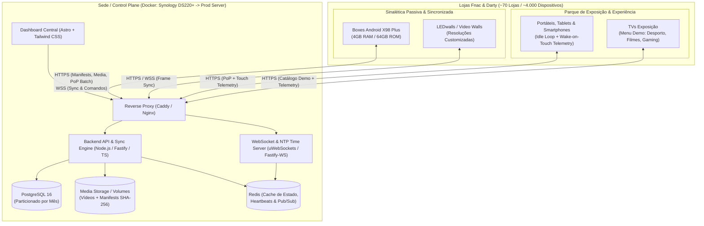
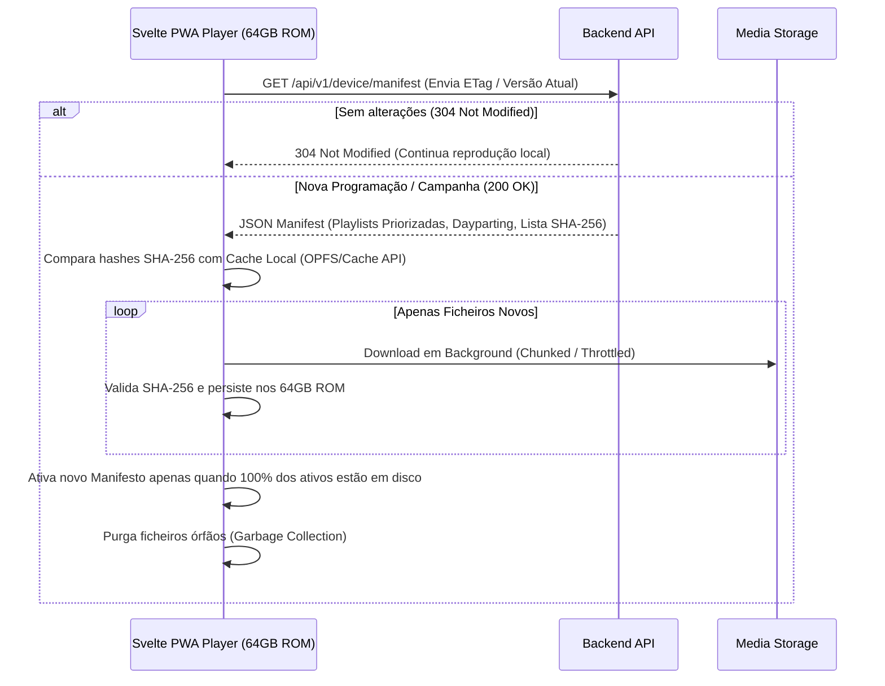

# 01 - Arquitetura do Sistema (Invision Nexus — Fnac & Darty)

> [!IMPORTANT]
> **Decisão Arquitetural Consolidada:** Dada a escala de produção (~70 lojas, ~4.000 dispositivos, retenção de 1 ano de Proof of Play e telemetria de interação), o **PostgreSQL 16+** (com particionamento declarativo mensal) e **Node.js (Fastify + TypeScript)** foram selecionados como stack oficial de Backend, descartando o SQLite/PocketBase para evitar bloqueios de escrita concorrente (*write-lock*).

---

## 1. Visão Geral da Arquitetura (High-Level Topology)

O sistema **Invision Nexus** opera num modelo **Hub-and-Spoke Resiliente (Edge Offline-First)**. O servidor central (alojado inicialmente em Docker no Synology DS220+ em Staging/Dev e posteriormente em servidor dedicado Enterprise para Produção) atua como *Control Plane*, enquanto os ~4.000 dispositivos atuam como nós autónomos (*Edge Players*) capazes de operar indefinidamente sem rede.

---

## 2. Componentes da Stack Tecnológica

| Camada | Tecnologia | Justificação Técnica (Escala 4.000 Devices) |
| :--- | :--- | :--- |
| **Base de Dados** | **PostgreSQL 16** (Docker) | Suporta escrita concorrente massiva (MVCC), `JSONB` para metadados flexíveis e **Particionamento Declarativo** para as tabelas de *Proof of Play* e *Interações* (~175M registos/ano). |
| **Cache & Real-Time** | **Redis 7** (Docker) | Absorve os *heartbeats* de 4.000 dispositivos a cada 60s sem sobrecarregar o disco do PostgreSQL; gere filas de comandos remotos e Pub/Sub de WebSockets. |
| **Backend / API** | **Node.js 22 LTS + Fastify + TypeScript** | Baixíssimo overhead de CPU/RAM (vital para o Celeron do Synology DS220+), validação de schemas via `Zod`/`TypeBox` e processamento de metadados de vídeo (`ffprobe`). |
| **Dashboard Central** | **Astro + Tailwind CSS** (SSR + Islands) | Interface ultra-rápida focada em Governance, gestão da Matriz de Slots/SoV, validação de formatos (*Format Guardrail*) e auditoria visual para as lojas. |
| **Edge Player** | **Svelte 5 PWA (Offline-First)** | Compilado sem runtime virtual DOM pesado — ideal para o chip Allwinner/Amlogic das Boxes Android X98 Plus (4GB RAM). Usa **Cache API / OPFS** para vídeos nos 64GB ROM e **IndexedDB** para fila de logs. |

---

## 3. Fluxos Críticos de Dados

### 3.1. Publicação e "Format Guardrail" (Prevenção de Erro de Formato)
1. O Gestor Multimédia faz upload de um ficheiro de vídeo/imagem atribuindo-o a uma **Insígnia** (`FNAC` ou `DARTY`).
2. O Backend analisa o ficheiro via `ffprobe` e extrai `width`, `height`, `aspect_ratio`, `codec`, `fps` e `sha256_hash`.
3. Quando o vídeo é adicionado a uma Playlist associada a um Terminal/Perfil de Ecrã (`ScreenProfile`), o **Format Guardrail** compara a resolução do vídeo com a resolução do terminal:
   - Se incompatível fora da tolerância definida, **bloqueia a publicação** (ou exige flag explícita de override com política de *object-fit: cover/contain*).

### 3.2. Sincronização Resiliente no Player (Manifest Pull + Delta Cache)

### 3.3. Motor de Prioridades e Modos de Playlist
O Player recebe todas as playlists válidas para a sua janela temporal e avalia localmente segundo a hierarquia estrita:
1. **`EXCLUSIVA` (Nível 1):** Silencia a 100% todas as outras playlists. Assume controlo total do ecrã.
2. **`PRIORITARIA` (Nível 2):** Se não houver `EXCLUSIVA`, silencia a 100% as playlists `NORMAL` e `FALLBACK`.
3. **`NORMAL` (Nível 3):** Programação regular de campanha/loja. Opera em dois modos selecionáveis na criação:
   - **Modo A (`FIXED_SLOTS`):** Matriz clássica de $N$ slots fixas (ex: 10 slots de 15s).
   - **Modo B (`DYNAMIC_SOV`):** Pesos percentuais de *Share of Voice* (ex: Campanha A = 40%, Campanha B = 60%) com algoritmo de *Weighted Round-Robin* que evita repetição consecutiva.
4. **`FALLBACK` (Nível 4):** Playlist institucional de segurança (por Insígnia/Tipologia). Toca apenas se nenhum dos níveis superiores tiver conteúdos válidos para a hora/data atual.

### 3.4. Telemetria Dual: Proof of Play (PoP) & Interação (Touch / TV Demo)
- **Proof of Play (Todos os 4.000 dispositivos):** Sempre que um vídeo termina a exibição, o Player incrementa o contador no IndexedDB para a chave `(device_id, media_id, playlist_id, hour_bucket)`. De hora a hora (com *jitter* aleatório de 0 a 300s para evitar *thundering herd* de 4.000 equipamentos às `:00`), envia o lote agregado para a API.
- **Métricas de Interação (Portáteis, Tablets, Smartphones e TVs Demo):**
  - **Parque Expo (Smartphones/Tablets/Portáteis):** Quando o cliente toca no ecrã ou move o rato/teclado, o Player sai do modo *Idle Loop* (ou abre a ficha/demo) e regista um evento de `TOUCH_WAKE` e `SESSION_DURATION_SECONDS`.
  - **TVs de Exposição (Modo Catálogo Demo):** O Player apresenta uma camada interativa (controlada por comando/touch) com categorias (*Desporto, Filmes, Gaming, Natureza 4K*). Cada seleção de categoria/vídeo pelo vendedor ou cliente é registada na tabela de telemetria de interações.
