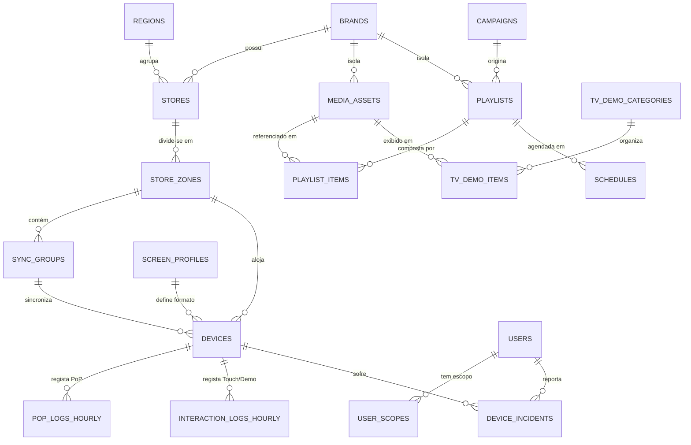

# 02 - Database Schema e Matriz de Governance (RBAC)

Este documento define o modelo relacional em **PostgreSQL 16+** e a matriz de permissões (RBAC) para a plataforma **Invision Nexus (Fnac & Darty)**.

---

## 1. Matriz de Governance e RBAC

> [!NOTE]
> Os utilizadores da equipa central operam de forma **transversal às duas insígnias (Fnac e Darty)**, mas os **conteúdos de media e playlists são estritamente isolados por insígnia** (`brand_id`) para evitar contaminação cruzada de marca.

### 1.1. Perfis de Utilizador (`Role`)

| Perfil (`role_code`) | Escopo de Visibilidade | Permissões de Conteúdo e Playlists | Permissões de Hardware / Terminais | Incidentes e Auditoria |
| :--- | :--- | :--- | :--- | :--- |
| **`GLOBAL_ADMIN`** *(Direção / Admin Multimédia)* | Global (Fnac + Darty, Todas as Lojas) | **CRUD Total:** Upload de media, criação de Playlists (`EXCLUSIVA`, `PRIORITARIA`, `NORMAL`, `FALLBACK`), configuração de Matriz de Slots e SoV, override de formato. | **CRUD Total:** Emparelhamento de boxes, definição de `ScreenProfile`, Reboot remoto, Clear Cache, Kill Switch. | Visualização global de PoP, métricas de Touch/TV Demo, gestão e resolução de incidentes. |
| **`IT_OPS`** *(Equipa Técnica / Suporte IT)* | Global ou Regional (Fnac + Darty) | **Leitura:** Visualiza o manifesto e playlists atribuídas a cada terminal para diagnóstico técnico. | **CRUD Total:** Emparelhamento de dispositivos, gestão de rede/versões, Reboot, Clear Cache, diagnóstico de sincronização NTP/WS. | Gestão técnica de incidentes de hardware/rede e alertas de offline. |
| **`MEDIA_MANAGER`** *(Equipa Gestão Multimédia)* | Global (Fnac + Darty, Todas as Lojas) | **CRUD Total:** Upload de media, gestão de Campanhas, Playlists, Slots/SoV, Categorias de TV Demo e Agendamentos (Dayparting). | **Leitura:** Consulta estado Online/Offline e resolução dos terminais (`ScreenProfile`) para validação de formato. | Consulta de relatórios de Proof of Play, métricas de interação e resposta a anomalias de conteúdo. |
| **`STORE_MANAGER`** *(Diretor de Loja)* | **Restrito à(s) sua(s) Loja(s)** | **100% Read-Only:** Auditoria visual em tempo real do que está programado e em exibição em cada zona/ecrã da sua loja (ex: LEDwall entrada). | **100% Read-Only:** Visualiza estado Online/Offline dos dispositivos da sua loja. | **Abrir / Consultar Incidentes:** Pode reportar anomalias num ecrã ou conteúdo da sua loja. |
| **`DEPT_HEAD`** *(Chefe de Departamento)* | **Restrito ao(s) seu(s) Departamento(s) na sua Loja** | **100% Read-Only:** Auditoria visual das playlists e vídeos ativos nos ecrãs e bancadas de exposição do seu setor (ex: Informática, Gaming, TVs). | **100% Read-Only:** Visualiza estado Online/Offline dos equipamentos do seu setor. | **Abrir / Consultar Incidentes:** Pode reportar anomalias nos terminais do seu departamento. |

---

## 2. Diagrama Entidade-Relacionamento (ERD)

---

## 3. Especificação das Tabelas (PostgreSQL DDL Conceptual)

### 3.1. Hierarquia Organizacional e Parque de Dispositivos

#### `brands` (Insígnias)
Isola estritamente os ativos de comunicação visual e playlists.
- `id` (UUID, PK)
- `code` (VARCHAR(20), UNIQUE) — `'FNAC'` | `'DARTY'`
- `name` (VARCHAR(100))
- `theme_config` (JSONB) — Cores institucionais e logótipo para fallback/UI.

#### `regions` (Países / Regiões)
- `id` (UUID, PK)
- `brand_id` (UUID, FK -> `brands.id`)
- `name` (VARCHAR(100)) — Ex: `'Portugal'`, `'França - Île-de-France'`
- `timezone` (VARCHAR(50)) — Ex: `'Europe/Lisbon'`

#### `stores` (Lojas — ~70 unidades)
- `id` (UUID, PK)
- `brand_id` (UUID, FK -> `brands.id`)
- `region_id` (UUID, FK -> `regions.id`)
- `store_code` (VARCHAR(20), UNIQUE) — Ex: `'FNAC-CLB'` (Colombo)
- `name` (VARCHAR(150))
- `opening_hours` (JSONB) — Horário padrão da loja para poupança energética / standby.
- `is_active` (BOOLEAN)

#### `store_zones` (Departamentos / Zonas Físicas)
- `id` (UUID, PK)
- `store_id` (UUID, FK -> `stores.id`)
- `zone_type` (VARCHAR(50)) — `'ENTRANCE_LEDWALL'`, `'IT_COMPUTERS'`, `'TELECOM_MOBILES'`, `'TV_VIDEO'`, `'GAMING'`, `'CHECKOUT'`, `'CULTURE_BOOKS'`
- `name` (VARCHAR(100))

#### `screen_profiles` (Perfis de Resolução e Formato — *Format Guardrail*)
Define as características físicas do ecrã para validação automática de conteúdos.
- `id` (UUID, PK)
- `name` (VARCHAR(100)) — Ex: `'Standard FullHD Landscape'`, `'Mupi Vertical 9:16'`, `'LEDwall Entrada Colombo (3840x1080)'`
- `width_px` (INT, NOT NULL)
- `height_px` (INT, NOT NULL)
- `aspect_ratio` (VARCHAR(20), NOT NULL) — Ex: `'16:9'`, `'9:16'`, `'32:9'`
- `orientation` (VARCHAR(20)) — `'LANDSCAPE'` | `'PORTRAIT'` | `'CUSTOM_LED'`
- `aspect_tolerance_pct` (NUMERIC(4,2), DEFAULT 2.00) — Tolerância máxima de desvio de rácio permitida sem bloqueio.

#### `sync_groups` (Grupos de Sincronização Milimétrica)
Agrupa dispositivos que têm de reproduzir o mesmo frame ao milissegundo (ex: corredor de 6 ecrãs ou Video Wall).
- `id` (UUID, PK)
- `store_zone_id` (UUID, FK -> `store_zones.id`)
- `name` (VARCHAR(100))
- `master_device_id` (UUID, NULLABLE) — Dispositivo líder de referência local (opcional).
- `sync_mode` (VARCHAR(30)) — `'NTP_TIMECODE'` | `'WS_BROADCAST'`

#### `devices` (Parque de ~4.000 Dispositivos)
- `id` (UUID, PK)
- `store_id` (UUID, FK -> `stores.id`)
- `store_zone_id` (UUID, FK -> `store_zones.id`)
- `sync_group_id` (UUID, NULLABLE, FK -> `sync_groups.id`)
- `screen_profile_id` (UUID, FK -> `screen_profiles.id`)
- `device_category` (VARCHAR(30), NOT NULL):
  - `'ANDROID_BOX'` (Box X98 Plus em TV/Monitor passivo)
  - `'LEDWALL'` (Painel LED de entrada/topo)
  - `'TV_DEMO'` (Televisor em exposição com menu interativo de categorias)
  - `'LAPTOP_EXPO'` (Portátil em bancada de exposição)
  - `'TABLET_EXPO'` (Tablet em bancada de exposição)
  - `'SMARTPHONE_EXPO'` (Smartphone em bancada de exposição)
- `hardware_uid` (VARCHAR(128), UNIQUE) — Identificador único/fingerprint do equipamento.
- `pairing_code` (VARCHAR(10), NULLABLE) — Código temporário de emparelhamento validado apenas por `GLOBAL_ADMIN` ou `IT_OPS`.
- `name` (VARCHAR(150))
- `interaction_mode` (VARCHAR(30), DEFAULT `'PASSIVE'`):
  - `'PASSIVE'` (Reprodução contínua sem toque)
  - `'IDLE_SCREENSAVER'` (Arranca vídeo após $X$ segundos de inatividade; fecha/pausa ao toque do cliente e conta interação)
  - `'INTERACTIVE_CATALOG'` (Modo TV Demo: permite escolher vídeos por categoria Desporto/Filmes/Gaming)
- `idle_timeout_sec` (INT, DEFAULT 45) — Segundos sem toque até retomar a playlist nos equipamentos `IDLE_SCREENSAVER`.
- `status` (VARCHAR(20)) — `'PENDING_APPROVAL'` | `'ONLINE'` | `'OFFLINE'` | `'MAINTENANCE'`
- `storage_free_bytes` (BIGINT) — Monitorização dos 64GB ROM.
- `current_manifest_hash` (VARCHAR(64)) — Confirma se o dispositivo já descarregou a última programação.
- `last_seen_at` (TIMESTAMPTZ)

---

### 3.2. Utilizadores, Escopos e Incidentes

#### `users`
- `id` (UUID, PK)
- `email` (VARCHAR(255), UNIQUE, NOT NULL)
- `password_hash` (TEXT, NOT NULL)
- `full_name` (VARCHAR(150))
- `role` (VARCHAR(30), NOT NULL) — `'GLOBAL_ADMIN'` | `'IT_OPS'` | `'MEDIA_MANAGER'` | `'STORE_MANAGER'` | `'DEPT_HEAD'`
- `is_active` (BOOLEAN, DEFAULT TRUE)

#### `user_scopes` (Associação N:M a Insígnias, Lojas e Departamentos)
Permite que a equipa multimédia tenha escopo global (`all_brands = true`, `all_stores = true`) e que um Diretor de Loja ou Chefe de Departamento veja apenas a sua Loja e/ou Departamentos específicos.
- `id` (UUID, PK)
- `user_id` (UUID, FK -> `users.id`)
- `brand_id` (UUID, NULLABLE, FK -> `brands.id`) — `NULL` significa acesso a Fnac + Darty.
- `store_id` (UUID, NULLABLE, FK -> `stores.id`) — `NULL` significa acesso a todas as lojas da insígnia.
- `store_zone_id` (UUID, NULLABLE, FK -> `store_zones.id`) — `NULL` significa acesso a todos os departamentos da loja.

#### `device_incidents` (Reporte de Anomalias pela Loja)
Permite que Diretores de Loja e Chefes de Departamento abram alertas sobre ecrãs ou conteúdos sem poderem alterar playlists.
- `id` (UUID, PK)
- `device_id` (UUID, FK -> `devices.id`)
- `reported_by` (UUID, FK -> `users.id`)
- `incident_type` (VARCHAR(40)) — `'SCREEN_OFF'` | `'WRONG_CONTENT'` | `'OUTDATED_PRICE'` | `'SYNC_DRIFT'` | `'HARDWARE_DAMAGE'`
- `description` (TEXT)
- `status` (VARCHAR(20)) — `'OPEN'` | `'IN_PROGRESS'` | `'RESOLVED'`
- `created_at` (TIMESTAMPTZ)
- `resolved_at` (TIMESTAMPTZ, NULLABLE)

---

### 3.3. Media, Playlists (Matriz de Slots & SoV) e Modo Demo TVs

#### `media_assets` (Catálogo de Conteúdos Isolado por Insígnia)
- `id` (UUID, PK)
- `brand_id` (UUID, NOT NULL, FK -> `brands.id`) — **Isolamento obrigatório Fnac vs. Darty**.
- `title` (VARCHAR(200), NOT NULL)
- `file_path` (TEXT, NOT NULL)
- `sha256_hash` (CHAR(64), NOT NULL) — Garante integridade no download offline para os 64GB ROM.
- `file_size_bytes` (BIGINT, NOT NULL)
- `mime_type` (VARCHAR(50)) — `'video/mp4'`, `'video/webm'`, `'image/webp'`
- `width_px` (INT, NOT NULL) — Extraído automaticamente no upload.
- `height_px` (INT, NOT NULL) — Extraído automaticamente no upload.
- `aspect_ratio` (VARCHAR(20), NOT NULL)
- `duration_ms` (INT, NOT NULL)
- `codec_info` (VARCHAR(100))
- `valid_from` (TIMESTAMPTZ, NULLABLE)
- `valid_until` (TIMESTAMPTZ, NULLABLE)
- `is_fallback_eligible` (BOOLEAN, DEFAULT FALSE) — Indica se este conteúdo pode servir de segurança institucional.
- `uploaded_by` (UUID, FK -> `users.id`)
- `created_at` (TIMESTAMPTZ)

#### `campaigns` (Campanhas de Marketing / Comercial)
- `id` (UUID, PK)
- `brand_id` (UUID, NOT NULL, FK -> `brands.id`)
- `name` (VARCHAR(200), NOT NULL) — Ex: `'Black Friday Fnac 2026'`, `'Lançamento iPhone 18'`
- `supplier_reference` (VARCHAR(100), NULLABLE) — Para relatórios de auditoria de Proof of Play a fornecedores.
- `start_date` (TIMESTAMPTZ, NOT NULL)
- `end_date` (TIMESTAMPTZ, NOT NULL)

#### `playlists` (Suporte Dual: Matriz de Slots Fixas ou Share of Voice Dinâmico)
- `id` (UUID, PK)
- `brand_id` (UUID, NOT NULL, FK -> `brands.id`)
- `campaign_id` (UUID, NULLABLE, FK -> `campaigns.id`)
- `name` (VARCHAR(200), NOT NULL)
- `target_screen_profile_id` (UUID, NOT NULL, FK -> `screen_profiles.id`) — **Format Guardrail:** só aceita `media_assets` compatíveis com este perfil de resolução!
- `priority_level` (VARCHAR(20), NOT NULL):
  - `'EXCLUSIVA'` (Peso 100 — Silencia todas as restantes)
  - `'PRIORITARIA'` (Peso 80 — Silencia `NORMAL` e `FALLBACK` a 100%)
  - `'NORMAL'` (Peso 50 — Programação regular)
  - `'FALLBACK'` (Peso 10 — Segurança institucional quando não há ativa)
- `scheduling_mode` (VARCHAR(25), NOT NULL):
  - `'FIXED_SLOTS'` (Modelo 1: Matriz com número fixo de slots numeradas `1..N`)
  - `'DYNAMIC_SOV'` (Modelo 2: Distribuição automática por percentagem de Share of Voice)
- `total_slots` (INT, NULLABLE) — Usado quando `scheduling_mode = 'FIXED_SLOTS'` (ex: Matriz de 12 slots).
- `is_active` (BOOLEAN, DEFAULT TRUE)
- `created_by` (UUID, FK -> `users.id`)

#### `playlist_items` (Itens da Playlist: Slots ou Percentagem SoV)
- `id` (UUID, PK)
- `playlist_id` (UUID, FK -> `playlists.id` ON DELETE CASCADE)
- `media_asset_id` (UUID, FK -> `media_assets.id`)
- `slot_position` (INT, NULLABLE) — Posição na grelha (`1..total_slots`) quando em modo `'FIXED_SLOTS'`.
- `sov_percentage` (NUMERIC(5,2), NULLABLE) — Percentagem alvo (`0.01` a `100.00`) quando em modo `'DYNAMIC_SOV'`.
- `custom_duration_ms` (INT, NULLABLE) — Para imagens ou override de duração.
- `scaling_policy` (VARCHAR(20), DEFAULT `'CONTAIN'`) — `'CONTAIN'` | `'COVER'` | `'STRETCH'` (caso um `GLOBAL_ADMIN` force um formato com ligeira diferença).

#### `schedules` (Agendamento com Dayparting e Alvos Hierárquicos)
Define **onde** e **quando** uma playlist toca.
- `id` (UUID, PK)
- `playlist_id` (UUID, FK -> `playlists.id` ON DELETE CASCADE)
- **Alvo (Target Polymorphic / Hierarchical):**
  - `target_type` (VARCHAR(30), NOT NULL) — `'BRAND_ALL'` | `'REGION'` | `'STORE'` | `'STORE_ZONE'` | `'SYNC_GROUP'` | `'DEVICE_CATEGORY'` | `'DEVICE'`
  - `target_id` (UUID, NULLABLE) — ID da Região, Loja, Zona, SyncGroup ou Device.
  - `target_device_category` (VARCHAR(30), NULLABLE) — Ex: aplicar a todos os `'LAPTOP_EXPO'` da loja ou insígnia.
- **Janela Temporal e Dayparting:**
  - `start_date` (DATE, NOT NULL)
  - `end_date` (DATE, NOT NULL)
  - `days_of_week` (SMALLINT[], DEFAULT `'{1,2,3,4,5,6,7}'`) — `1=Segunda ... 7=Domingo`.
  - `daypart_start_time` (TIME, DEFAULT `'00:00:00'`) — Ex: `'09:00:00'`
  - `daypart_end_time` (TIME, DEFAULT `'23:59:59'`) — Ex: `'13:30:00'`

#### `tv_demo_categories` & `tv_demo_items` (Modo Exposição de TVs por Categoria)
Estrutura dedicada para os televisores em exposição onde o utilizador/vendedor escolhe o tipo de conteúdo para testar qualidade de imagem.
- **`tv_demo_categories`:**
  - `id` (UUID, PK)
  - `brand_id` (UUID, FK -> `brands.id`)
  - `name` (VARCHAR(100)) — Ex: `'Desporto 120Hz'`, `'Cinema HDR / OLED'`, `'Gaming Consola 4K'`, `'Natureza & Cores'`
  - `icon_name` (VARCHAR(50))
  - `display_order` (INT)
- **`tv_demo_items`:**
  - `id` (UUID, PK)
  - `category_id` (UUID, FK -> `tv_demo_categories.id` ON DELETE CASCADE)
  - `media_asset_id` (UUID, FK -> `media_assets.id`)
  - `highlight_specs` (JSONB) — Badges exibidas no ecrã durante o teste (ex: `{"resolution": "4K UHD", "hdr": "Dolby Vision", "fps": "60fps"}`).
  - `display_order` (INT)

---

### 3.4. Telemetria e Auditoria (Tabelas Particionadas por Mês — Retenção 1 Ano)

> [!TIP]
> **Otimização para 4.000 Dispositivos:** Ambas as tabelas abaixo usam `PARTITION BY RANGE (hour_bucket)`. A criação da partição do mês seguinte e o arquivo/drop das partições com mais de **12 meses** são automatizados via job de manutenção.

#### `pop_logs_hourly` (Proof of Play Agregado por Hora)
- `hour_bucket` (TIMESTAMPTZ, NOT NULL) — Hora truncada (ex: `2026-11-13 14:00:00Z`).
- `device_id` (UUID, NOT NULL)
- `store_id` (UUID, NOT NULL) — Desnormalizado para queries rápidas de relatório por loja sem `JOIN` pesado.
- `brand_id` (UUID, NOT NULL) — Desnormalizado para relatórios por insígnia.
- `campaign_id` (UUID, NULLABLE)
- `playlist_id` (UUID, NOT NULL)
- `media_asset_id` (UUID, NOT NULL)
- `play_count` (INT, NOT NULL, DEFAULT 0) — Número de exibições completas nessa hora.
- `total_duration_ms` (BIGINT, NOT NULL, DEFAULT 0) — Tempo total exibido em milissegundos.
- **Primary Key Composta (Upsert Idempotente):** `(hour_bucket, device_id, playlist_id, media_asset_id)`

#### `interaction_logs_hourly` (Telemetria de Touch e Escolha de Demo TVs)
Regista o envolvimento dos clientes nos Portáteis, Smartphones, Tablets e TVs de Exposição.
- `hour_bucket` (TIMESTAMPTZ, NOT NULL)
- `device_id` (UUID, NOT NULL)
- `store_id` (UUID, NOT NULL)
- `device_category` (VARCHAR(30), NOT NULL) — `'LAPTOP_EXPO'`, `'SMARTPHONE_EXPO'`, `'TABLET_EXPO'`, `'TV_DEMO'`
- `interaction_type` (VARCHAR(40), NOT NULL):
  - `'TOUCH_WAKE'` (Cliente tocou no smartphone/tablet/portátil e interrompeu o screensaver)
  - `'TV_CATEGORY_SELECT'` (Cliente/Vendedor escolheu uma categoria na TV Demo, ex: Gaming)
  - `'TV_VIDEO_PLAY'` (Vídeo específico de demonstração acionado manualmente na TV)
- `reference_id` (UUID, NULLABLE) — ID da `tv_demo_categories` ou `media_asset_id` selecionado (ou `NULL` para wake geral).
- `interaction_count` (INT, NOT NULL, DEFAULT 0) — Número de sessões/toques iniciados nessa hora.
- `total_engaged_seconds` (INT, NOT NULL, DEFAULT 0) — Tempo total em que o equipamento esteve a ser manuseado pelo cliente antes de regressar ao *Idle Loop*.
- **Primary Key Composta:** `(hour_bucket, device_id, interaction_type, COALESCE(reference_id, '00000000-0000-0000-0000-000000000000'))`
