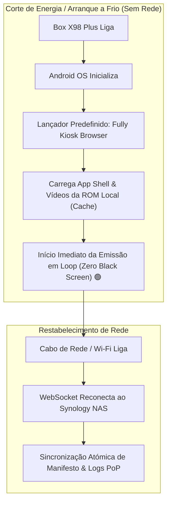

# Manual 03: Provisionamento Kiosk (Boxes Android X98 Plus, Fully Kiosk Browser & Sincronização ao Milissegundo)

Este manual descreve como preparar e operar os terminais em loja: **Boxes Android X98 Plus (4GB RAM / 64GB ROM)**, **LEDwalls**, **TVs em Exposição (`TV_DEMO`)** e **Parque de Exposição (`LAPTOP_EXPO`, `TABLET_EXPO`, `SMARTPHONE_EXPO`)**.

---

## 1. Arquitetura Kiosk de Retalho: Fully Kiosk Browser (Padrão FNAC / DARTY)

No retalho comercial europeu, o navegador padrão do Android (Google Chrome) não é utilizado diretamente como interface primária de ecrã por não dispor de modo Kiosk com bloqueio nativo de sistema operativo (permite que clientes saiam para o desktop do Android com o comando da TV e não arranca de forma autónoma a frio se não houver rede).

A plataforma Invision Nexus adota o **Fully Kiosk Browser** como motor de execução dedicado para as Boxes X98 Plus:



### Vantagens do Fully Kiosk no Ecossistema Invision Nexus:
1. **Zero-Network Cold Boot (Arranque sem Rede):** Registado no Android como aplicação `HOME` nativa (`cmd package set-home-activity de.ozerov.fully/.MainActivity`). Ao ligar a ficha à tomada, mesmo com o cabo de rede desligado e sem Wi-Fi, a Box entra diretamente no Player sem nunca exibir o ambiente de trabalho da TV.
2. **Bloqueio Anti-Vandalismo Estrito:** Inibe fisicamente as teclas *Home*, *Back*, menus de contexto, gestos táteis e atalhos de teclado/rato. Ninguém na loja consegue fechar o ecrã.
3. **Cache Web Agressiva:** Mantém em disco flash (64GB ROM) todo o App Shell (HTML, JS, CSS) e media, eliminando o ecrã cinzento de erro do Chrome.

### Como obter o Fully Kiosk Browser APK (2 Métodos Rápidos):
* **Método 1 (Diretamente na Box Android — Mais Rápido):**
  1. No ecrã da TV com o comando da Box X98 Plus, abra a **Google Play Store**.
  2. Pesquise por **Fully Kiosk Browser** e clique em **Instalar**.
  3. Assim que a app estiver instalada, corra o script de provisionamento no Mac/NAS — o script deteta a aplicação instalada de imediato!
* **Método 2 (Download do APK no PC/Mac):**
  1. Aceda à página oficial de download: 👉 **[https://www.fully-kiosk.com/en/#download-box](https://www.fully-kiosk.com/en/#download-box)** (ou na página principal [https://www.fully-kiosk.com](https://www.fully-kiosk.com) e clique no botão azul *"Download APK"*).
  2. Guarde o ficheiro descarregado na pasta `tools/apk/fully-kiosk.apk` do projeto.
  3. Execute o script de provisionamento: o APK é transferido e instalado automaticamente na Box via ADB.

---

## 2. Provisionamento Automatizado ADB para Boxes Android X98 Plus

O script `scripts/provision-x98-kiosk.sh` automatiza toda a configuração de fábrica via rede local:

```bash
chmod +x scripts/provision-x98-kiosk.sh

# Modo A: Com deteção/instalação automática do APK colocado em tools/apk/
./scripts/provision-x98-kiosk.sh 192.168.68.115 http://192.168.68.117:5174

# Modo B: Indicando o caminho direto do APK do Fully Kiosk
./scripts/provision-x98-kiosk.sh 192.168.68.115 http://192.168.68.117:5174 ./tools/apk/fully-kiosk.apk
```

### O que o script configura automaticamente:
1. **Limpeza e Prevenção de Abas Duplicadas:** Antes de iniciar o Player, o script força a paragem do browser (`am force-stop`) e limpa o ficheiro de abas anteriores (`app_tabs/*`). O Player é iniciado com a flag `FLAG_ACTIVITY_CLEAR_TASK` (`0x10008000`), garantindo que **nunca se acumulam múltiplas abas em segundo plano**, libertando toda a memória RAM e GPU da Box.
2. **Instalação do APK:** Se o Fully Kiosk não estiver instalado na Box, procura qualquer instalador `.apk` na pasta `tools/apk/` e instala-o via ADB com concessão automática de permissões (`-g`).
3. **Ativação como Home Launcher:** Configura o Fully Kiosk como aplicação Home do sistema operativo (`cmd package set-home-activity de.ozerov.fully/.MainActivity`).
4. **Injeção de Definições de Kiosk:**
   - `startUrl`: URL do Player (`http://192.168.68.117:5174`).
   - `autostart = true`: Arranque instantâneo no boot.
   - `kioskMode = true`: Bloqueio contra saída e sobreposição.
   - `enableOfflineCache = true`: Cache persistente em disco.
   - `keepScreenOn = true` e `preventDeviceSleep = true`: Ecrã permanentemente ativo.
   - `showActionBar = false` e `showStatusBar = false`: Ocultação de barras de navegação.
5. **Energia e HDMI-CEC:** Desativa o *Sleep*, protetor de ecrã Android e o desligar automático via HDMI-CEC (`stay_on_while_plugged_in = 7`).
6. **Fallback PWA com Service Worker:** Caso o Fully Kiosk ainda não esteja instalado, provisiona o Google Chrome em aba única limpa com o Service Worker Offline-First e ecrã imersivo.

---

## 3. Modo de Manutenção & Utilitário de Controlo de Kiosk (`kiosk-control.sh`)

Quando um técnico necessita de inspecionar a Box (por exemplo, aceder às Definições do Android, abrir a Google Play Store para verificar se o Fully Kiosk foi instalado ou configurar Wi-Fi), o Watchdog automático (que verifica a cada 12 segundos) **não deve forçar a reabertura do Player**.

Para isso, foi criado o utilitário `scripts/kiosk-control.sh` e botões de ação dedicados no Dashboard Central (`/devices`):

### 3.1. Comandos Rápidos de Terminal:
```bash
# 1. Pára imediatamente o Player e pausa o Watchdog (deixa a TV livre no Desktop Android):
./scripts/kiosk-control.sh stop 192.168.68.115

# 2. Verifica se o Fully Kiosk Browser está instalado e se é o Home Launcher:
./scripts/kiosk-control.sh check 192.168.68.115

# 3. Elimina 100% das abas acumuladas no Google Chrome (Chrome Reset completo):
./scripts/kiosk-control.sh clear-tabs 192.168.68.115

# 4. Relança o Player e reativa a supervisão de 12 segundos:
./scripts/kiosk-control.sh resume 192.168.68.115
```

### 3.2. Controlo Remoto via Dashboard Central (`/devices/`):
Na secção **"Provisionamento Kiosk ADB & Auto-Boot Watchdog"**, cada Box dispõe dos seguintes botões de ação:
* **`🛑 Parar Player`:** Força a paragem (`am force-stop`) do Chrome e do Fully Kiosk e suspende o Watchdog, permitindo usar a Box livremente com o comando da TV.
* **`🧹 Limpar Abas`:** Executa `pm clear com.android.chrome`, eliminando todas as abas antigas e sessões restauradas.
* **`🔍 Verificar Kiosk`:** Executa um teste em tempo real na Box e confirma se o pacote `de.ozerov.fully` está presente.
* **`⏸️ Pausar / ▶️ Ativar Watchdog`:** Alterna a vigilância automática sem fechar o ecrã.
* **`🔄 Abrir URL`:** Relança o Player em modo Kiosk limpo e reativa a supervisão.

---

## 4. Sincronização Multi-Ecrã ao Milissegundo (`MillisecondSyncEngine`)

Para corredores de ecrãs ou Video Walls pertencentes ao mesmo `SyncGroup`:
- **Calibração NTP via WebSockets (`/ws/sync`):** Calcula o *Round-Trip Time (RTT)* e o *Clock Offset* filtrando as amostras de menor jitter.
- **Resiliência Offline (Corte de WAN):** Guarda o último offset e o declive de deriva do cristal (`driftSlopePpm`) em `localStorage` e suporta medição de tempo via gateway local da loja.
- **Micro-Pacing sem Cortes Bruscos:**
  - Desvio `< 15ms`: Mantém `playbackRate = 1.00`.
  - Desvio entre `15ms` e `150ms`: Ajusta suavemente a velocidade (`0.98x` ou `1.02x`) até alinhar ao milissegundo sem salto visual.
  - Desvio `> 150ms`: Executa *Hard Seek* imediato para a posição determinística `SyncedEpochMs % LoopTotalDurationMs`.

---

## 5. Atalho Secreto de Diagnóstico em Loja (Hidden OSD Menu)

Em frente a qualquer ecrã na loja:
- **Com Rato / Touch:** Clique **5 vezes seguidas no canto superior esquerdo** do ecrã.
- **Com Teclado / Comando Box Android:** Pressione a tecla **`F12`** ou **`i`**.

O painel mostra em tempo real:
- Espaço livre nos **64GB ROM** e estado `PERSISTED`;
- Estado do **Dual-Buffer Video Deck** (`Deck A` vs `Deck B`);
- Contadores locais acumulados no **IndexedDB** (*Proof of Play* e *Interações Touch/TV Demo*);
- **Offset NTP em milissegundos** e estado do *Micro-Pacing*;
- Botões rápidos para alternar entre os modos `PASSIVE`, `IDLE_SCREENSAVER` e `INTERACTIVE_CATALOG`.

