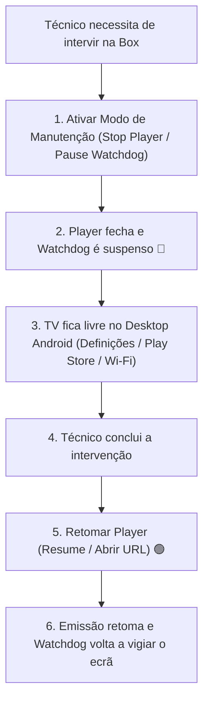

# Manual 06: Operação Diária, Manutenção de Campo & Resolução de Problemas (Boxes Android X98 Plus)

> **Invision Nexus — FNAC & DARTY**  
> **Classificação:** Documento Técnico-Operacional / Guia de Campo (Runbook)  
> **Versão:** 1.0 (Novembro 2026) • **Alvo:** Boxes Android X98 Plus (4GB RAM / 64GB ROM)

---

## 1. Âmbito & Objetivo Operacional

Este manual constitui o **Procedimento Operacional Padrão (SOP)** para as equipas de suporte informático de loja (IT Ops), técnicos de manutenção e direções de loja.

O seu propósito é fornecer respostas rápidas, práticas e determinísticas para as operações do dia-a-dia no parque de terminais de Digital Signage:
1. Como intervir numa Box sem que o sistema de auto-recuperação interfira com o técnico.
2. Como diagnosticar e resolver problemas visuais (abas acumuladas, quebras de vídeo, ecrãs pretos).
3. Como gerir a transição entre o modo Google Chrome e o Fully Kiosk Browser.
4. Como restabelecer a operação após cortes de energia ou substituição física de equipamentos.

---

## 2. A Mecânica da Supervisão: O Modo de Manutenção

### 2.1. O Ciclo do Watchdog (Auto-Boot)
Para garantir que nenhum ecrã de loja fica desligado ou no ambiente de trabalho do Android após uma quebra momentânea de energia, a plataforma Invision Nexus executa um **Watchdog contínuo (a cada 12 segundos)** a partir do Synology NAS.
* Se a Box for reiniciada ou o Player fechar acidentalmente, o Watchdog deteta o evento e **reabre automaticamente o Player em Fullscreen**.

### 2.2. Por que razão é indispensável o "Modo de Manutenção"?
Quando um técnico precisa de intervir na Box física (ex: configurar uma nova rede Wi-Fi, alterar a resolução HDMI para 4K, emparelhar um comando Bluetooth ou abrir a Google Play Store), **o Watchdog interpretaria essa ação como uma anomalia** e forçaria a abertura do Player a cada 12 segundos, bloqueando o técnico.

Por isso, **antes de qualquer intervenção física na Box, deve ativar-se o Modo de Manutenção (Parar Player / Pausar Watchdog)**:



---

## 3. Matriz de Controlo: Terminal CLI vs. Dashboard Central

O operador pode executar todas as operações de manutenção através de duas vias equivalentes:

| Operação Desejada | Via Terminal CLI (`scripts/kiosk-control.sh`) | Via Dashboard Web (`/devices/`) |
| :--- | :--- | :--- |
| **Parar Player & Pausar Watchdog** | `./scripts/kiosk-control.sh stop <IP_BOX>` | Botão vermelho **`🛑 Parar Player`** |
| **Verificar Instalação do Fully Kiosk** | `./scripts/kiosk-control.sh check <IP_BOX>` | Botão verde **`🔍 Verificar Kiosk`** |
| **Limpar 100% das Abas do Chrome** | `./scripts/kiosk-control.sh clear-tabs <IP_BOX>` | Botão cinzento **`🧹 Limpar Abas`** |
| **Ligar/Desligar Supervisão sem Fechar** | `./scripts/kiosk-control.sh pause-watchdog` | Botão amarelo **`⏸️ Pausar / ▶️ Ativar Watchdog`** |
| **Definir Fully Kiosk como Home Launcher** | `./scripts/kiosk-control.sh set-home <IP_BOX>` | Automático no provisionamento |
| **Relançar Player & Reativar Supervisão** | `./scripts/kiosk-control.sh resume <IP_BOX>` | Botão azul **`🔄 Abrir URL`** |

---

## 4. Cenários Operacionais do Dia-a-Dia (Playbook de Campo)

### Cenário A: Quero aceder às Definições da Box ou à Google Play Store
1. No seu computador (ou portátil na loja), execute:
   ```bash
   ./scripts/kiosk-control.sh stop 192.168.68.115
   ```
   *(Ou no Dashboard Central, clique em **`🛑 Parar Player`** na linha dessa Box).*
2. Olhe para a TV: o Player fecha imediatamente e surge o ambiente de trabalho normal do Android.
3. Com o comando da Box, aceda livremente a **Definições**, **Rede Wi-Fi**, **Google Play Store**, etc. O servidor **não voltará a abrir o Chrome por cima**.
4. Quando terminar a intervenção, retome a emissão:
   ```bash
   ./scripts/kiosk-control.sh resume 192.168.68.115
   ```
   *(Ou no Dashboard, clique em **`🔄 Abrir URL`**).*

---

### Cenário B: Instalar e Validar o Fully Kiosk Browser na Box
O Fully Kiosk Browser garante que a Box arranca no Player mesmo sem cabo de rede ligado (*Zero-Network Cold Boot*).

#### Passo 1: Verificar se já está instalado
Execute:
```bash
./scripts/kiosk-control.sh check 192.168.68.115
```
* Se devolver `🟢 INSTALADO`: passe ao Passo 3.
* Se devolver `🔴 NÃO INSTALADO`: siga o Passo 2.

#### Passo 2: Instalação (Duas Opções)
* **Via Play Store na Box (Recomendado):**
  1. Pare o Player: `./scripts/kiosk-control.sh stop 192.168.68.115`
  2. No comando da Box, abra a **Google Play Store**.
  3. Pesquise por **`Fully Kiosk Browser`** e clique em **Instalar**.
* **Via Ficheiro APK no PC/Mac:**
  1. Aceda a [https://www.fully-kiosk.com/en/#download-box](https://www.fully-kiosk.com/en/#download-box) e clique em *"Download APK"*.
  2. Guarde o ficheiro em `tools/apk/fully-kiosk.apk`.
  3. Execute o provisionamento: `./scripts/provision-x98-kiosk.sh 192.168.68.115 http://192.168.68.117:5174`

#### Passo 3: Ativar como Lançador Principal do Android
Uma vez instalado, execute:
```bash
./scripts/kiosk-control.sh set-home 192.168.68.115
./scripts/kiosk-control.sh resume 192.168.68.115
```
A Box fica permanentemente blindada: arranca a frio no Player e inibe saídas acidentais.

---

### Cenário C: O Chrome está a abrir abas antigas ou duplicadas
Se a Box ainda estiver a usar o Google Chrome e notar que estão abas acumuladas em segundo plano:

1. **Causa Técnica:** O Chrome guarda o histórico de sessões anteriores no seu armazenamento interno. Como o utilizador padrão de rede não pode apagar ficheiros de sistema de terceiros, os métodos normais não fecham as abas.
2. **Solução Imediata (Chrome Reset):**
   Execute:
   ```bash
   ./scripts/kiosk-control.sh clear-tabs 192.168.68.115
   ./scripts/kiosk-control.sh resume 192.168.68.115
   ```
   *(Ou no Dashboard, clique em **`🧹 Limpar Abas`** e depois em **`🔄 Abrir URL`**).*
3. **Preservação de Dados de Loja:** O comando limpa o registo de abas sem desconfigurar o equipamento. O URL reinicia passando o `hw_uid` determinístico físico da Box, garantindo que o emparelhamento central se mantém 100% intacto.

---

### Cenário D: Substituição Física de uma Box Avariada
Se uma Box X98 Plus avariar e for substituída por uma nova unidade de reserva:

1. Ligue a nova Box à energia e ao cabo de rede da loja.
2. Nas definições do Android, confirme que as **Opções de Programador** e a **Depuração USB / Rede** estão ativas e anote o IP atribuído pelo router (ex: `192.168.68.120`).
3. No computador de gestão, execute o provisionamento de fábrica:
   ```bash
   ./scripts/provision-x98-kiosk.sh 192.168.68.120 http://192.168.68.117:5174
   ```
4. No Dashboard Central (`http://192.168.68.117:4322/devices/`), aprove o emparelhamento ou reatribua a nova Box à mesma Loja/Departamento da Box anterior.

---

## 5. Tabela de Resolução Rápida de Sintomas (Troubleshooting)

| Sintoma Observado | Causa Provável | Solução Recomendada |
| :--- | :--- | :--- |
| **TV volta ao Player mal tento abrir Definições** | O Watchdog do NAS está ativo a vigiar o ecrã. | Executar `./scripts/kiosk-control.sh stop <IP>` ou clicar em `🛑 Parar Player`. |
| **Aparecem várias abas do Chrome na barra superior** | Sessões antigas acumuladas antes da ativação do reset. | Executar `./scripts/kiosk-control.sh clear-tabs <IP>` ou clicar em `🧹 Limpar Abas`. |
| **Ecrã exibe dinossauro "Sem Internet" após corte de energia** | A Box arrancou sem rede e o Fully Kiosk não está instalado. | Instalar Fully Kiosk Browser (`check` -> Play Store) para carregar o Player da ROM. |
| **Comando da TV permite sair para o menu Android** | A Box está a correr Chrome em vez de Fully Kiosk como Home App. | Executar `./scripts/kiosk-control.sh set-home <IP>`. |
| **Ecrã ficou preto após toque acidental** | Video player em pausa por evento de foco. | Clicar em `⛶ Fullscreen` no Dashboard ou pressionar `i` no teclado/comando. |
| **Box não responde a comandos ADB (`offline` ou `refused`)** | IP alterado por DHCP ou Wi-Fi desligado. | Verificar IP nas definições de rede da TV e reconectar cabo Ethernet. |

---

## 6. Contactos & Escalação de Suporte
* **Nível 1 (Loja):** Operador de Manutenção / Chefe de Departamento Multimédia.
* **Nível 2 (Sistemas):** Administrador de Infraestrutura Synology NAS / Docker Invision Nexus.
* **Nível 3 (Engenharia):** Auditoria de Cibersegurança & Desenvolvimento Core Invision Nexus.
